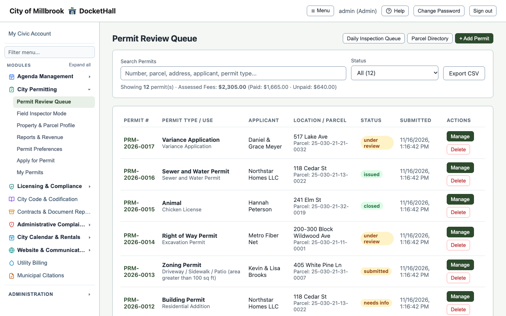

#  DocketHall

**All-in-one, WCAG 2.1 AA accessible municipal website, council agendas, online permitting, city code, and public records platform for small cities.**

**[Live Demo](https://demo.dockethall.com/)** · **[Project Website](https://www.dockethall.com/)** · **[Feature Tour](docs/FEATURES.md)** · **[Self-Hosting Guide](docs/SELF_HOSTING.md)**

---

DocketHall is built for city clerks, staff, councilmembers, inspectors, and residents who want modern municipal software without enterprise bloat, per-seat licensing, or fragmented tools. Every city gets a complete **Public Services & Records Portal** paired with a modular **Staff & Council Workspace**—100% open source under [AGPLv3](LICENSE).

> **Try the Live Demo:** Visit **[demo.dockethall.com](https://demo.dockethall.com/)** for a pre-seeded example city (**City of Millbrook**) with one-click **City Clerk**, **Inspector**, and **Resident** demo sign-in (resets automatically every 2 hours).


## Why DocketHall?

- **Everything in One Platform:** Public website, emergency alerts, agendas & minutes, online permitting, inspections, contractor licensing, municipal code, FOIA/public records, 311/complaints, calendar & facility rentals, and utility/citation billing.
- **Built for WCAG 2.1 AA Accessibility:** Accessible semantic templates, keyboard navigation, color contrast, required alt-text prompts, and built-in PDF/UA accessibility checks help cities meet DOJ Title II web accessibility requirements.
- **No Per-User Fees or Locked Modules:** Unlimited staff, council, and resident accounts—enable only the modules your city uses under **Administration → Manage Modules**.
- **Complete Data Ownership:** Your city owns its domain and all public records. Export a full `.zip` archive of database records, agendas, CSVs, and attachments at any time, or configure scheduled S3 offsite snapshots.
- **Clerk-Friendly Packet & Minutes Workflow:** Compile multi-format agenda packets (`.pdf`, `.docx`, `.xlsx`, `.pptx`, images) or upload pre-assembled agendas, run **Live Meeting Mode** with roll-call voting, and publish attested Minutes PDFs.

## Platform Overview

Explore the full **[Feature Tour with Screenshots](docs/FEATURES.md)**, or jump to a module:

| Area | Highlights |
| --- | --- |
| **Public Portal** (`/`, `/portal`, `/code`) | Global search, urgent alert banner, city blog, email alert subscriptions, transparency snapshot, standalone permits & city code portals |
| **Agendas & Live Meetings** | Governing bodies, posting-notice audit badges, multi-format packet builder, single-PDF upload, live meeting speaker timer & roll-call voting, attested minutes |
| **Permits & Inspections** | Custom permit catalog & fee schedules, online intake, multi-department review, Field Inspector mode, parcel/property profiles, PDF receipts |
| **Licensing & Compliance** | Contractor license/insurance/bond tracking (blocks non-compliant submissions), recurring Rental/STR/Fire/Backflow compliance programs |
| **City Code** | Chapter/section tree editor, bulk PDF/URL codification studio, clickable `§` cross-references, revision history, compiled Full-Code PDF |
| **Public Records & FOIA** | Contracts, resolutions & ordinances repository, expiration alerts, agenda-to-archive promotion, online FOIA / Data Practices request workflow |
| **Complaints, 311 & Work Orders** | Confidential/anonymous complaint intake, investigation workbench, reinspection & NOV queue, 311 Public Works work orders |
| **Communications & Calendar** | City blog + RSS, public notices/bids/jobs, custom pages, dynamic forms & polls, city directory & FAQs, facility reservations & `.ics` feeds |
| **Utilities & Citations** | Water/sewer/trash utility billing, municipal code/parking citations, online payments, and hearing/contest requests |

| Council Agendas & Packets | Permits Review Queue | Searchable City Code |
| --- | --- | --- |
|  |  |  |

## Quick Start (Self-Hosted)

Run DocketHall locally or on your own server with Docker Swarm:

```bash
git clone https://github.com/ryanhankins/DocketHall.git
cd DocketHall
./scripts/deploy.sh
```

Once running:
- **Public Portal:** <http://localhost:8080>
- **Permits Portal:** <http://localhost:8080/portal>
- **City Code:** <http://localhost:8080/code>
- **Workspace:** <http://localhost:8080/app> (default first-run login: `admin` / `admin` — change immediately)

For production VPS deployment (automatic Caddy HTTPS, `ufw` + `fail2ban`, `unattended-upgrades`, offsite backups) and environment configuration, see the **[Self-Hosting Guide](docs/SELF_HOSTING.md)**.

## Repository Layout

- `web/` — Nginx reverse proxy and React 19 + Vite frontend (`index.html`, `app.html`, `portal.html`, `code.html`, `src/core/`, and `src/modules/`)
- `api/` — Python FastAPI backend (`main.py`, core services, module routers, and PDF/accessibility tooling)
- `db/` — PostgreSQL initialization script (`init.sql`)
- `scripts/` — Swarm deployment (`deploy.sh`), turnkey VPS installer (`install-vps.sh`), city provisioning (`provision-city.sh`), health check (`health-check.sh`), offsite backup (`backup-offsite.sh`), and teardown (`teardown.sh`) scripts
- `docs/` — [Feature Tour](docs/FEATURES.md), [Self-Hosting Guide](docs/SELF_HOSTING.md), and screenshots
- `docker-stack.yml` — Docker Swarm stack definition

## License

Licensed under the [GNU Affero General Public License v3.0](LICENSE).
