# DocketHall Feature Tour

**[Live Demo](https://demo.dockethall.com/)** · **[Project Website](https://www.dockethall.com/)** · **[Self-Hosting Guide](SELF_HOSTING.md)** · **[Back to README](../README.md)**

DocketHall pairs a WCAG 2.1 AA accessible **Public Services & Records Portal** with a modular **Staff & Council Workspace**. Modules can be enabled or disabled individually under **Administration → Manage Modules** without losing stored data.

---

## 1. Public Municipal Portal (`/`, `/portal`, `/code`)

Every public section and published record has a clean, bookmarkable URL:
- **Public Services Overview (`/`)**: Global search, customizable welcome banner, urgent emergency alert bar, city blog feed preview, **Transparency Snapshot** bar, and **Public Email Alerts** (self-service citizen subscriptions with one-click unsubscribe links).
- **Standalone Permits Portal (`/portal`)**: Resident-friendly permit catalog with fee schedules, required documents, and one-click application launch.
- **Standalone City Code (`/code`)**: Searchable chapters and nested sections with highlighted snippets, clickable cross-references (e.g. `§ 618.040`), section permalinks, per-section PDFs, and a **Full-Code Compiled PDF** with Table of Contents.

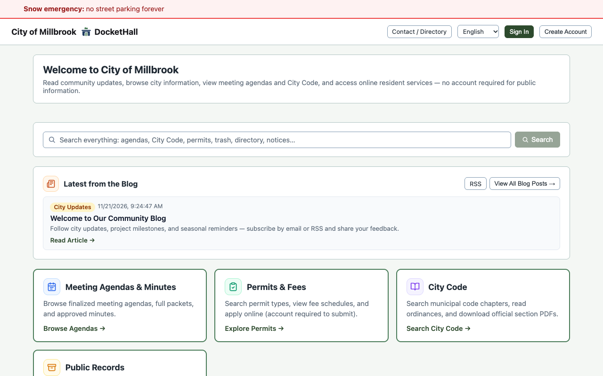

| Public Permits Portal (`/portal`) | Searchable City Code (`/code`) |
| --- | --- |
| 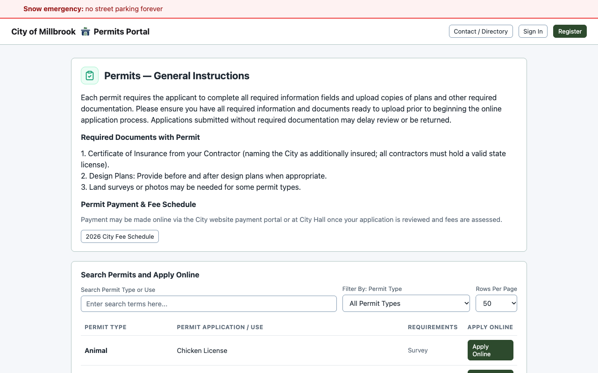 | 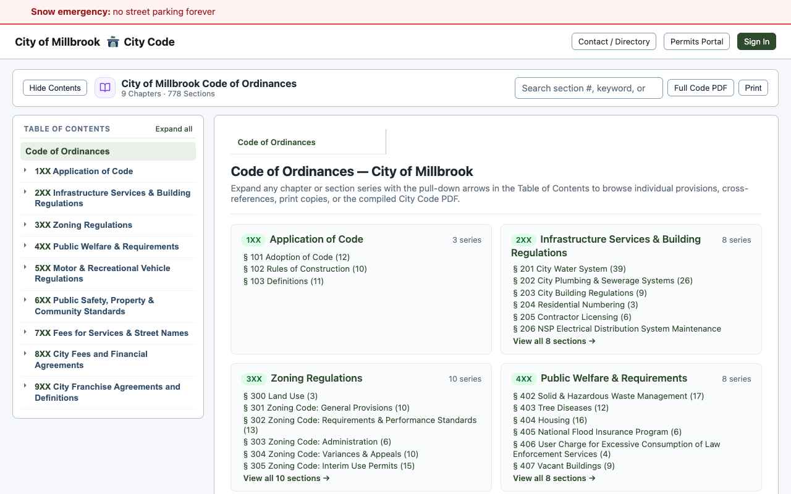 |

---

## 2. Council Agendas, Packets & Live Meetings (`agendas`)

Built for city clerks to assemble packets quickly and satisfy open-meeting notice requirements:
- **Governing Bodies & Workflows**: Configurable boards/commissions, agenda sections, workflow categories, default meeting times/locations, **Councilmember Roster**, and **Open-Meeting Posting Notice Window** warnings with a **Proof-of-Posting Audit** badge (`Posted Xh before meeting`).
- **Multi-Format Packet Compilation**: Combine `.pdf`, `.docx`, `.xlsx`, `.pptx`, `.csv`, `.txt`, `.md`, `.png`, and `.jpg` attachments (or upload a pre-assembled single agenda PDF) with optional item cover sheets, continuous page numbers, and **Tagged PDF/UA accessibility** checks.
- **Live Meeting Mode**: Step-by-step in-meeting view with a **Public Comment Speaker Timer** (`2m` / `3m` / `5m`), **Call to Order / Adjourn** timestamping, and live **Motion / Second / Roll-Call Voting** that compiles straight into Draft Minutes.
- **Draft & Attested Minutes**: Generates watermarked `DRAFT` PDFs until marked **Approved**, which adds an **Official Clerk Attestation** & verification block.
- **Todos, Backlog & Cloning**: Reusable **Agenda Templates**, agenda **Cloning**, **Todos & Backlog** (including recurring monthly/quarterly/annual items), and **Councilmember Item Submissions**.

| Agendas & Packet Management | Agenda Detail & Live Meeting Tools |
| --- | --- |
| 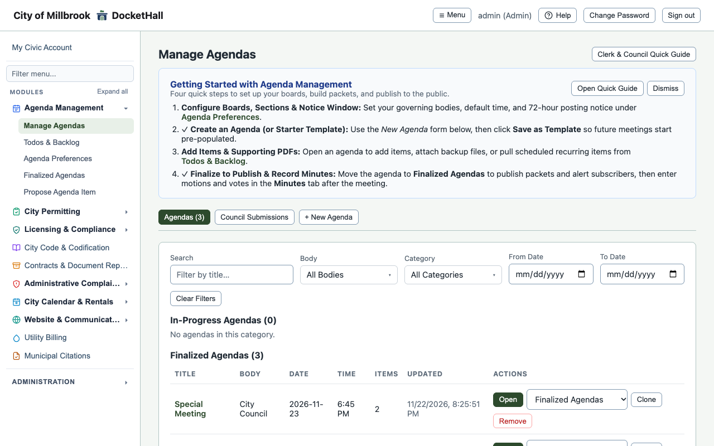 | 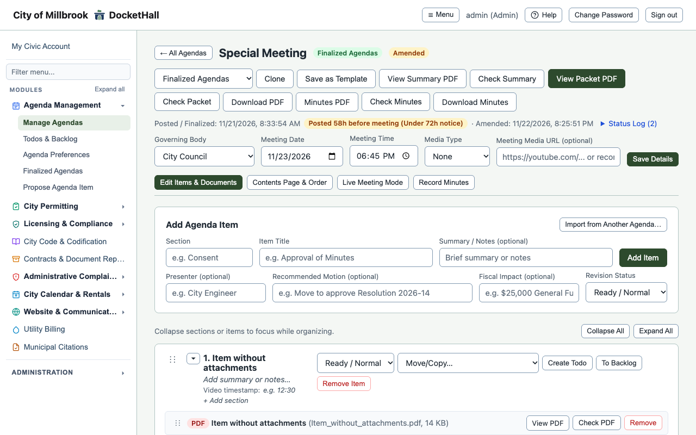 |

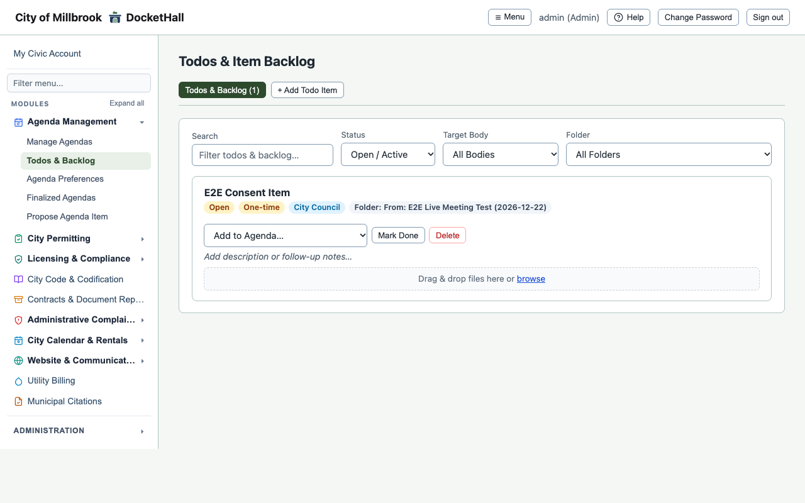

---

## 3. Online Permitting, Inspections & Property Profiles (`permits`)

End-to-end permitting without third-party add-ons:
- **Configurable Permit Catalog**: Define permit types, uses, fee schedules, custom intake fields, and required documents.
- **Online Intake & Review**: Residents and contractors apply online (`/app/permits-apply`) and track status, staff messages, and receipts (`/app/my-permits`). Staff review applications through multi-department workflows and generate Permit/Receipt PDFs.
- **Field Inspector Mode**: Mobile-friendly inspection queue, checklist completion, and field notes.
- **Parcel / Property Profiles**: Unified property history linking permits, inspections, compliance programs, and code-enforcement complaints to each address.

| Permits Review Queue | Field Inspector Mode |
| --- | --- |
| 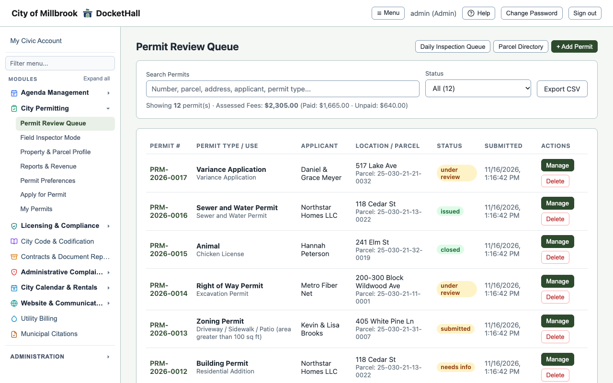 | 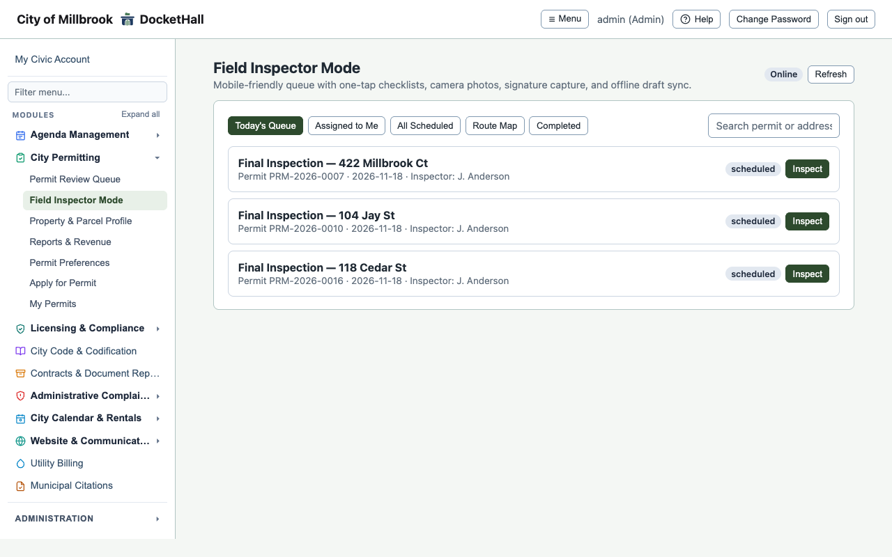 |

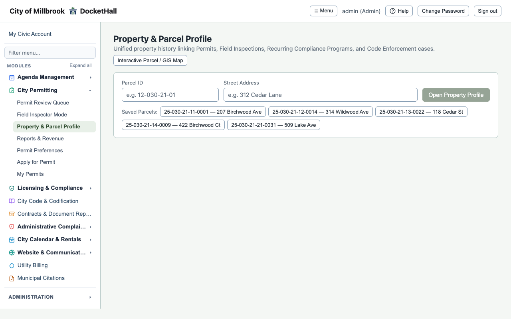

---

## 4. Contractor Licensing & Compliance Programs (`licensing`)

- **Contractor Registry**: Track contractor licenses, liability insurance, and surety bonds—automatically blocking expired or non-compliant contractors at permit submission.
- **Recurring Compliance Programs**: Manage Rental, Short-Term Rental (STR), Fire, and Backflow inspection programs with automated 30-day renewal reminders and generated Compliance Certificates.

| Contractor Licensing | Compliance Programs |
| --- | --- |
| 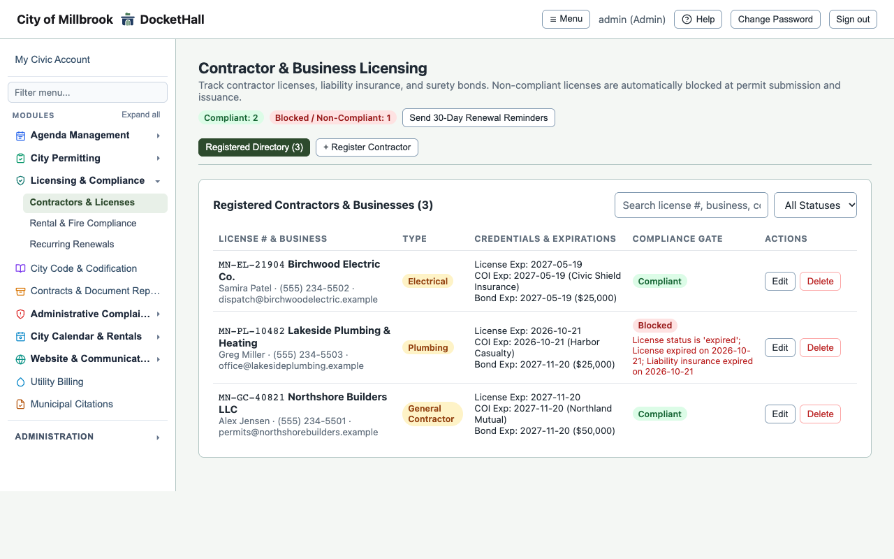 | 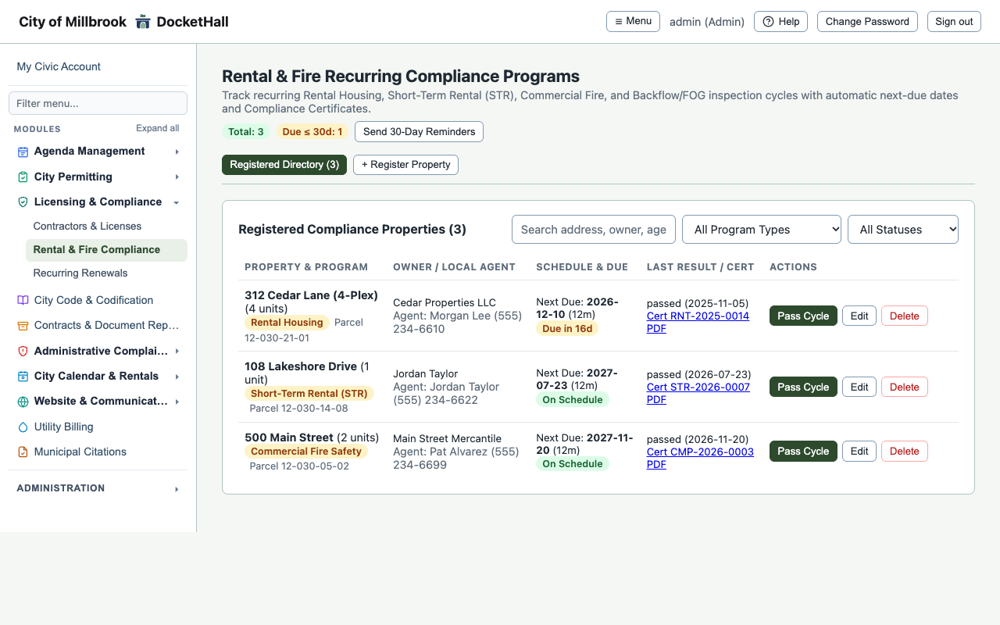 |

---

## 5. Additional Built-In Modules

- **City Code (`codification`)**: Chapter & section tree editor, bulk import & codify studio (PDF/URL/sync), full revision history, and compiled Full-Code PDF generation.
- **Public Records & FOIA (`records`)**: Searchable repository for contracts, resolutions, ordinances, and agreements (including direct promotion from finalized agenda items), expiration/renewal alerts, and a **FOIA / Data Requests** workflow.
- **Complaints, 311 & Work Orders (`complaints`)**: Anonymous, resident, and staff oral complaint intake, confidential complainant data isolation, investigation workbench, reinspection & Notice of Violation (NOV) deadline queue, and 311 Public Works work orders.
- **Calendar & Facility Reservations (`calendar`)**: Municipal meeting/event calendar, facility catalog, online reservation requests, and `.ics` calendar feeds.
- **Communications Suite (`communications` — `blog`, `notices`, `pages`, `forms`, `directory`)**: City Blog with RSS (`/api/blog/rss.xml`), Public Notices/Bids/Jobs, Custom Pages & Quick Links, Dynamic Forms & Opinion Polls, and City Directory & FAQs.
- **Utility Billing (`utilities`) & Municipal Citations (`citations`)**: Manage water/sewer/trash bills, municipal code/parking citations, online payments, and hearing/contest requests.

| Utility & Citation Billing | Mobile-Responsive Workspace |
| --- | --- |
| 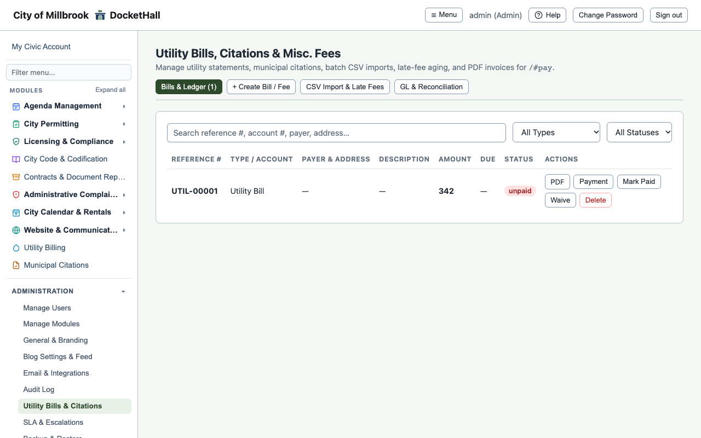 | 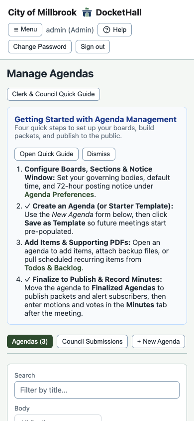 |

---

## 6. Administration, Security & Data Ownership

- **Manage Modules**: Toggle modules on or off per city without losing data.
- **Users, Roles & Audit Log**: Role-based access (`admin`, `council_member`, `admin_staff`, `non_admin_staff`, `applicant`, `read_only`) with per-user permission overrides and a full audit trail.
- **WCAG 2.1 AA Guardrails**: Accessible semantic templates, required alt-text prompts, and built-in PDF accessibility checks.
- **Full Backup, Offsite S3 & Restore**: Export and restore complete `.zip` archives (PostgreSQL + uploaded documents), or schedule automated S3/SeaweedFS offsite snapshots with downloadable snapshot history.

| Modular Administration | Backup & Restore |
| --- | --- |
| 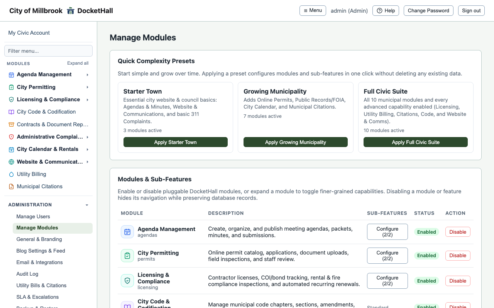 | 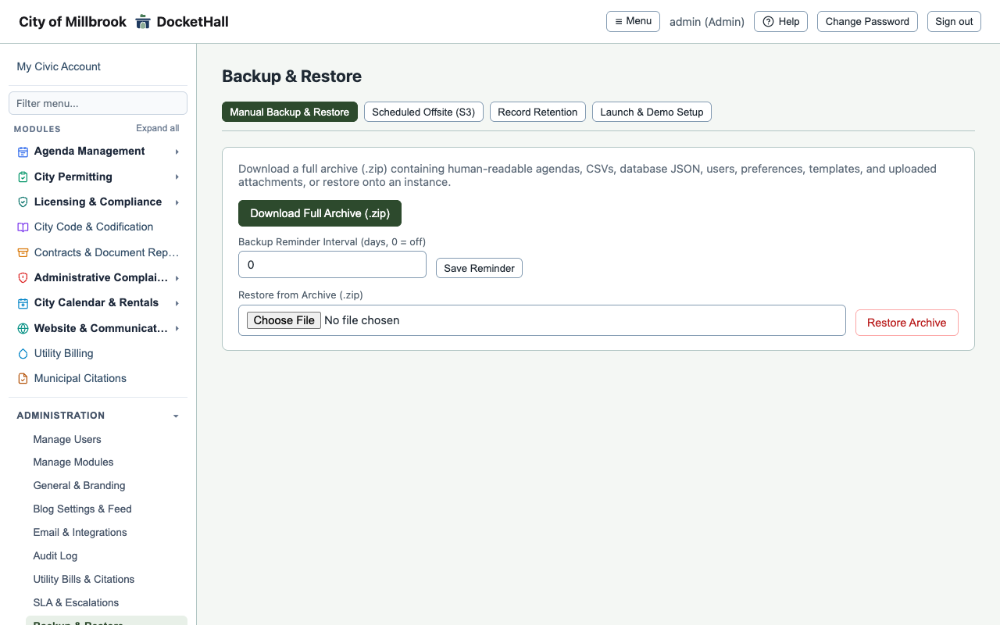 |
